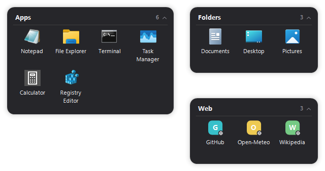
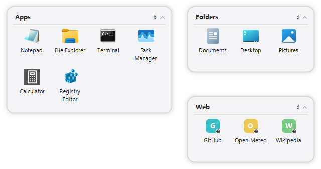
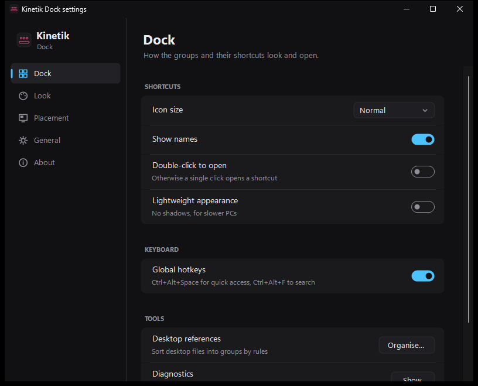
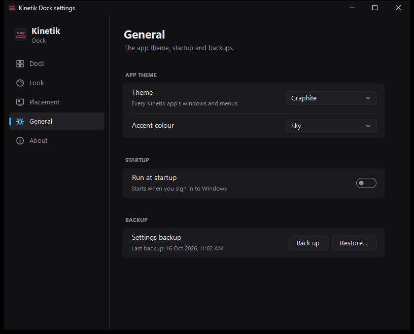
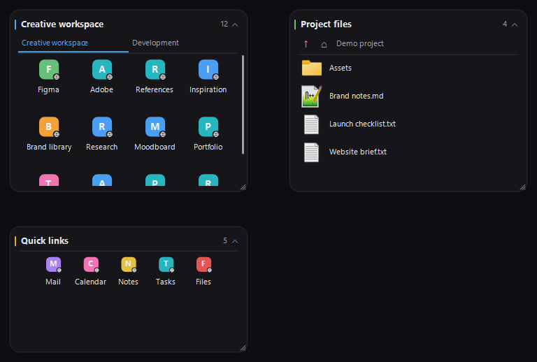

# Kinetik Dock: groups of shortcuts on the Windows desktop

**Kinetik Dock** is a free, open-source app for Windows 11 and Windows 10 that keeps **groups of shortcuts on your desktop**: apps, files, folders and web links, each group in its own card. Think desktop fences, in the look of [Kinetik Stats](https://github.com/WastedDesigner/Kinetik), the taskbar system monitor.

It's a small portable app with no installer and no account.

> **About this project:** I made this for my own desktop and decided to share it in case anyone else finds it useful. If you run into a bug or have an idea for a feature, please open an issue.

## What's new in 2.0

Part of the Kinetik apps, with [Kinetik Stats](https://github.com/WastedDesigner/Kinetik) (the taskbar monitor, called just Kinetik until its v4.0), [Kinetik Hub](https://github.com/WastedDesigner/KinetikHub) and the other desktop widgets.

- **A new settings window** (right-click → **Settings…**) replaces the old one: icon size, names, how shortcuts open, hotkeys, desktop organisation and diagnostics, then Look, Placement, General and About.
- **App theme:** one theme and accent colour for every Kinetik app's windows and menus: Match Windows, Graphite, OLED black, Midnight, Nord, Mocha, Forest, Light or Paper, with a Sky, Violet, Mint, Amber, Rose or Coral accent or your Windows accent. Pick it in Settings → General, under **App theme** in the right-click menu, in Kinetik Hub or in Kinetik Stats, and every app follows.
- **Widget themes:** new **OLED black** and **Mocha**, and **Match app theme**, which uses the app theme and accent colour.
- **New icon** in the Kinetik apps' "Graphite glass" style.

## Features

### New in 1.2: desktop organisation and lower rendering costs

- **Resize and scroll:** drag a group's edges or corners; columns adapt to its width. Large groups draw only their visible rows. Use the wheel or scrollbar to browse.
- **Folder portals:** right-click a group or the tray → **New folder portal** to browse a live folder. Open subfolders, go up/home/back/forward, filter files and sort by name, type, modified date or size. Original files stay in place.
- **Tabs:** right-click a group → **Tabs → Combine with**. Switch using the tab strip; use its overflow menu for more tabs, or detach a tab from its menu.
- **Workspaces:** create and select named layouts from the **Workspaces** menu; move individual groups with **Move to workspace**.
- **Quick access:** **Ctrl+Alt+Space** temporarily raises your current groups above other windows. Press it again or **Escape** to restore their normal layer.
- **Instant shortcut search:** **Ctrl+Alt+F** searches saved references across workspaces and currently loaded portal contents. Type, choose a result and press Enter.
- **Multiple items:** Ctrl-click to toggle selection, Shift-click to select a range, then drag the selection. Hold Ctrl during an internal drop to copy references. Selected items also have bulk move/remove menu actions.
- **Keyboard access:** right-click → **Select items with keyboard**. Use arrows, Shift, Ctrl+A, Enter, F2, Delete, Ctrl+Z/Y and Escape. Delete removes Dock references only; portal files cannot be deleted from this view. Shortcut names, paths and actions are exposed to accessibility tools.
- **Desktop organisation:** **Organise desktop references** previews filename rules and destinations. Add only checked matches, and optionally watch for new desktop items. Rules use `*`, `?`, `;` and `<folders>`; the first match wins. This feature adds references and does not move or hide original desktop files.
- **Undo and snapshots:** use **Layout and history** for undo/redo, collapse/expand all and JSON export/import. Import adds groups; undo can revert the import. Undo history is kept in memory for the current session.
- **Personalise each group:** compact spacing, list view, icon size, labels, accent colour and individual locking. **Settings and diagnostics** includes searchable behaviour settings, a lightweight appearance option and resource counters.
- **Less repeated work:** affected-group redraws, merged updates, bounded icon/existence caches, delayed settings saves, background shell launches and watcher/surface cleanup for inactive groups.

Portals show up to 5,000 matching items per folder; use Explorer for larger collections. New keyboard shortcuts can be disabled in Settings if another app uses them. The tray menu provides the same actions. Portal copy/move/delete operations, native desktop icon management and Windows virtual-desktop binding remain future work.

The controlled 1,000-item rendering benchmark and its limits are documented in [PERFORMANCE_1.2.md](PERFORMANCE_1.2.md). The broader candidate backlog and release coverage are in [FEATURE_AND_OPTIMISATION_PLAN.md](FEATURE_AND_OPTIMISATION_PLAN.md).

### Existing features

- **Any number of groups**, each with its own name, number of columns and place on screen
- **Drop to add:** drag apps, shortcuts, files or folders from File Explorer, or a link from your browser's address bar, onto a group
- **Click to open**; right-click a shortcut to show it in File Explorer, rename it, change what it opens, or move it to another group
- **Drag to rearrange** within a group or move a shortcut to another group. You can also drag one out onto anything that takes files.
- **Roll up:** double-click a group's title to fold it down to just its title bar
- **Real icons** from Windows at any size (small, normal or large), with names under them or not. Web links get a coloured letter tile.
- **Missing targets** (a removed app, an unplugged drive) are faded out rather than dropped
- **Groups line up:** when you drag a group near another one or near a screen edge, it snaps into line with it
- **Themes** in the Kinetik apps' style, a choice of fonts, size and background opacity; on the desktop, normal windows or always on top; lock them all in place
- **Settings backup** next to the exe, offered again on a fresh Windows

## Download and use

1. Download `KinetikDock.zip` from Releases and extract it anywhere.
2. Run `KinetikDock.exe`. It starts with one empty group: drop some shortcuts on it.
3. Right-click a group for Add, Columns, Roll up, New group and the style settings. Right-click a shortcut for its own menu.

Settings, including the groups, are kept in `HKCU\Software\KinetikDock`. The app makes no network connections: it only opens what you click.

## Requirements

Windows 10 or 11 (64-bit) with .NET Framework 4.8, which ships with both.

## Building from source

No SDK needed: `build.bat` compiles `KinetikDock.cs`, `DockFeatures.cs`, `DesktopOrganisation.cs` and `SuiteSupport.cs` with the .NET Framework compiler that ships with Windows. `build.bat package` also makes `KinetikDock.zip` for a release.

`KinetikDock.exe --demo` runs a separate copy with made-up groups that reads and saves no settings. Add `--theme Light` (or any theme name) to pick its theme, and `--shot file.png` to draw the groups into a PNG and quit, which is how the screenshots were made.

## Tests and packaging

`python tests/run-tests.py` runs the regression checks (no window opens). `build.bat package` builds the exe and makes the release zip, checking every file in it against its SHA-256 hash. The shared support code (`SuiteSupport.cs`) is compiled into the exe, so there's no extra DLL.

`powershell -File tests/run-dock-tests.ps1` runs the Dock integration checks in isolated demo mode with temporary fixtures; it briefly creates test group windows and never reads or saves your Dock layout. `powershell -File tests/run-benchmark.ps1` runs the repeatable 1,000-shortcut rendering benchmark. `tests/measure-idle.ps1 -Exe <absolute-exe-path>` measures the default demo after settling.

## License

[GPL-3.0-or-later](LICENSE). Copyright © 2026 Akila Sella Hennedige.
